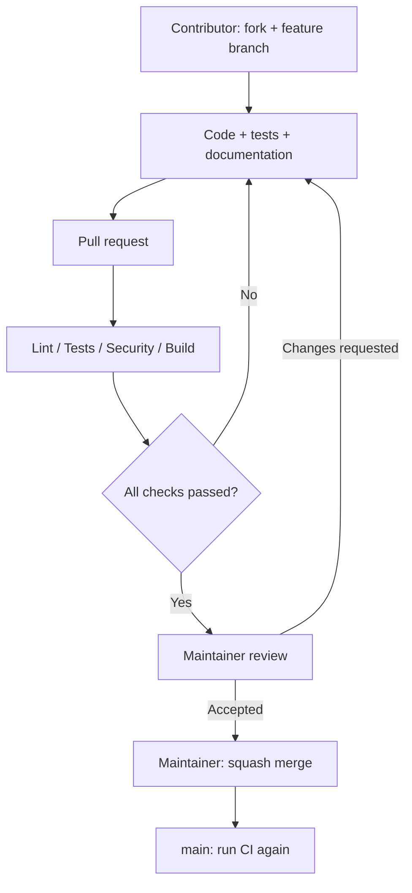

# PipeForge: a simple development plan

The goal is a small Python framework for validating and running a pipeline locally, then using it in CI. Start with a working core and add tests and documentation alongside the code.

Motto: **Define once. Run anywhere. Debug locally.**

The initial core is implemented: a Python package, CLI and bootstrap launcher `./run`, jobs/steps/run, a DAG and job selection, a shell executor, a values/secrets/Git resolver, streaming secret masking, a colored summary, JSON/Markdown reports, unit/integration tests and a CI workflow. The current MVP is `0.1.0`; automated publishing is described in [releasing.md](releasing.md). See [configuration.md](configuration.md) for the implemented format and [CONTRIBUTING.md](../CONTRIBUTING.md) for validation commands. The GitHub settings below must be reviewed and applied separately after the first successful server CI run.

## 1. Minimal architecture

```text
CLI → Config loader → Resolver → Engine → Executor
                                  ↓          ↓
                             Logger + masking
```

| Component | Responsibility |
| --- | --- |
| CLI | `validate`, `run`, `run --dry-run`; clear errors and exit codes |
| Config | Safe YAML loading, structure validation, rejection of unknown fields |
| Resolver | `${values.*}` values and `${secrets.*}` secrets from the environment |
| Engine | Sequential step execution; stop after the first failure |
| Executor | Command execution, working directory, timeout, process termination |
| Logger | Step name, timing, result, redaction of known secrets |

Current structure:

```text
src/pipeforge/
  __init__.py
  cli.py
  errors.py
  config.py
  resolver.py
  engine.py
  executor.py
  logging.py
tests/
  unit/
  integration/
examples/pipelines/basic/pipeforge.yml
.github/workflows/review.yml
pyproject.toml
```

Do not create empty directories for every future module. Extract subpackages when the code needs them.

“One pipeline across CI systems” means the same PipeForge format and behavior with the same dependencies. The user or runner provides Python, the shell, Docker and other external tools. The operating system and installed tools can affect results.

## 2. Initial working contract

- Python 3.11+; the executor runs on Linux/macOS. CI includes a Linux matrix and a macOS job; Windows is not supported yet.
- The default file is `pipeforge.yml`; `name` and a nonempty `jobs` mapping are required; the legacy `pipeline` format remains compatible.
- A job has `steps` and optional `needs`; a step has `run` and an optional `name`. The graph executes sequentially in topological order.
- `validate` checks structure and references without running commands. Required secrets are checked before `run`; dry-run does not print their values.
- Success returns `0`; configuration and execution failures return documented nonzero codes.
- `${git.sha}`, `${git.short_sha}`, `${git.branch}` and `${git.tag}` are supported through values/env. Environment overlays, plugin discovery and Git modules are later milestones.
- Colors are enabled for interactive terminals; plain text is suitable for CI.

Declare secrets through environment variables without real values in YAML. Do not load `.env` automatically. Values and secrets are substituted only in step `env`; scripts read ordinary shell variables or `os.environ`. PipeForge does not insert secrets into shell text, but script authors are responsible for how their commands use the environment.

## 3. Automated checks

One `review.yml` defines four stable check names. Checks run in parallel on PRs and pushes to `dev`/`main`; every PR update runs them again.

| Check | What it runs |
| --- | --- |
| Lint | `ruff check`, `ruff format --check`, `mypy` for the package |
| Tests | `pytest`: unit + integration on Linux, Python 3.11–3.13; macOS, Python 3.12 |
| Security | Bandit for project code and `pip-audit` for installed dependencies |
| Build | Wheel/sdist build, metadata validation, wheel installation in a clean environment and CLI smoke test |

Matrix job names include the operating system and Python version. The final **Tests** job uses `if: always()` and checks that every matrix job succeeded; failure, cancellation or skipping cannot produce a successful result. Add this aggregate job name to the ruleset.

Do not add path filters to the required workflow: documentation-only PRs also need the required checks. A dependency scan that could not run is not a success. Pin validation tool versions and GitHub Actions commit SHAs, and update them through Dependabot.

First run CI successfully on real code, then add the four check names to the ruleset. Do not add placeholders that always pass. The CI PR must record matching local and server commands.

## 4. What to test

| Level | Examples |
| --- | --- |
| Unit | Invalid YAML, unknown fields, missing values, cyclic references, missing required secrets |
| Unit | Masking repeated, overlapping and multiline secrets; safe resolver errors |
| Integration | CLI subprocess execution from a temporary directory, a real hello-world pipeline |
| Integration | A failed second step prevents the third; timeout; stderr; nonzero exit code |
| Integration | Dry-run executes nothing; secrets stay out of stdout, stderr and error messages |
| Package | Wheel installation without a project checkout; working entry point; example execution |

Tests do not require AWS, a Docker daemon, production credentials or a network connection. For future integrations, unit tests use mocks; real external tests run separately in a controlled environment. Coverage helps identify gaps; an arbitrary percentage does not replace failure testing.

## 5. Contributors and review



Anyone can create a fork and PR without direct write access to upstream. Initially, only the maintainer has write/admin access. CODEOWNERS routes reviews to `@CloudOpsMaster`, but does not block merging on its own.

The maintainer checks whether the problem is solved, the API is clear, failures are tested, secrets cannot leak and documentation matches the implementation. Workflow and dependency changes also need careful review. Successful checks do not prove arbitrary code is safe.

With `approvals = 0`, GitHub does not require human approval. This is the initial mode for a single maintainer: contributors propose changes and the maintainer merges them. An author cannot provide the required approval for their own PR.

When a second maintainer joins, add them to CODEOWNERS, require one approval and code-owner review, and dismiss approvals after new commits. Another person then reviews maintainer-authored PRs too. CODEOWNERS controls review routing and requirements; access permissions determine who can merge.

## 6. GitHub settings

This document does not change Settings automatically.

| Setting | Initial value |
| --- | --- |
| Ruleset | Active, default branch; no routine bypass actors |
| Protection | Restrict deletions, block force pushes, require PRs |
| Merge | Squash only; automatically delete head branches |
| Review | Zero approvals while there is one maintainer; resolve conversations |
| Required checks | Lint, Tests, Security, Build after the first successful CI run |
| Up-to-date branch | Enable together with required checks |
| Actions | Enabled; read-only token; prevent Actions from creating/approving PRs |
| Fork PR | GitHub-hosted runner; approve external contributor workflow runs |
| Security | Dependabot alerts, security updates, secret scanning and push protection where available |
| Releases | Version + changelog in a PR; automatic tag/release after successful main CI |

The PR workflow uses `pull_request`, `permissions: contents: read`, `persist-credentials: false` during checkout and job timeouts. Do not run unreviewed PR code through `pull_request_target`, with production secrets or on self-hosted runners. Permission to run CI for a fork PR is separate from approving its code for merge.

Add Dependabot version updates for pip alongside `pyproject.toml`, and for GitHub Actions alongside the workflow. Weekly updates and a small open-PR limit are sufficient.

About: `Reusable CI/CD framework for local and CI pipeline execution.` Initial topics: `cicd`, `devops`, `python`, `automation`, `github-actions`. Add other topics when their integrations exist.

GitHub behavior details: [CODEOWNERS](https://docs.github.com/en/repositories/managing-your-repositorys-settings-and-features/customizing-your-repository/about-code-owners), [Actions permissions and forks](https://docs.github.com/en/repositories/managing-your-repositorys-settings-and-features/enabling-features-for-your-repository/managing-github-actions-settings-for-a-repository).

## 7. Implementation order

1. **Implemented: package + CLI + CI:** `pyproject.toml`, `src/pipeforge`, CLI help, tests, four real checks and Dependabot. Server CI execution and enabling required checks are the next actions after publishing the changes.
2. **Implemented: config + executor:** validation, sequential shell steps, timeout, exit codes, hello-world, output limits and process group cleanup.
3. **Implemented: resolver + logs:** values, environment secrets, masking, dry-run and terminal colors; regression tests cover errors and secret leaks. Logs stream through a redactor; the colored console includes a summary, `-v` and `-vv`. Reports and logs live in `.pipeforge/runs/`; `latest` points to the last completed run.
4. **Prototype v0.1.0:** current documentation, clean installation, manual validation and changelog; then a tag/release at the maintainer's discretion.
5. **Extensions:** start with one useful module, such as Docker, and a minimal module contract. Git modules with verified immutable commits, other CI adapters, environment overlays and diagnostics are separate follow-up tasks.

Releases do not happen after every merge. The release job publishes verified artifacts from the same main CI run when the version in `pyproject.toml` changes. Add PyPI publishing later through Trusted Publishing and a protected environment. Release `v1.0.0` after the public API and configuration format stabilize; document incompatible changes in the changelog even before 1.0.

## Next milestones after jobs + launcher

1. Container executor: the same image locally and in CI; current host execution does not yet guarantee an identical environment.
2. A minimal `uses` plugin API and one Docker module.
3. Terraform/Kubernetes/Helm modules and environment overlays.
4. Remote modules with immutable commit verification; `doctor`.
5. ForgeAI after the report schema stabilizes: rules → explanations → suggestions; then a classifier/optional LLM. No automatic destructive commands or decorative confidence scores.

Working branches: `feature/*` → `dev` → verified `main`; releases use `v*` tags without a `prod` branch. Do not advertise new capabilities as supported until implementation and tests exist.
