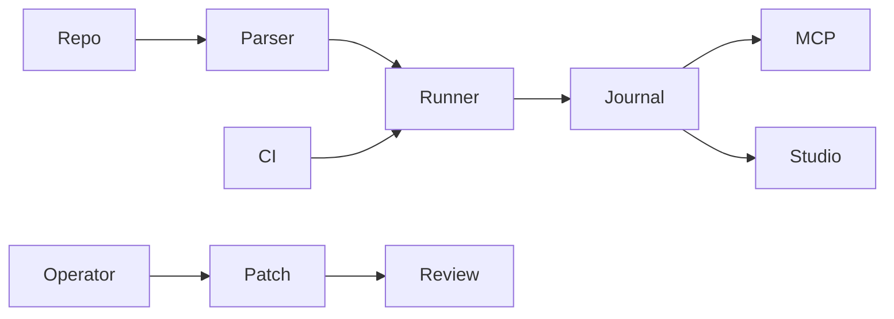

# PipeForge portable rules threat model

## Executive summary

The highest-risk boundary is a privileged runner executing repository-controlled code. Inputs reach the command through typed arguments or environment variables. Reports consume untrusted process output and provide another path for accidental disclosure.

## Scope and assumptions

Scope covers the installed CLI, legacy job runner, portable rules, wrapper compilers, event reports, read-only MCP and local promotion patches. The CLI runs on developer hosts and controlled CI runners. The archive specifies reviewed configuration, read-only AI and PR-based promotion. Controller, registry and hosted CI administration are external. Runner network reachability, credential lifetimes and cloud identity policy depend on deployment.

## System model

### Primary components

`cli.py` routes legacy invocations and versioned commands. `config.py` and `rules.py` parse YAML. `rule_runtime.py` and `executor.py` run code as the current OS user. `studio.py` transforms local journals. `rule_ci.py` generates or recognizes trusted wrappers. `gitops.py` drafts files for human review.

### Data flows and trust boundaries

- Repository → CLI over the local filesystem. Bounded safe YAML parsing, duplicate-key rejection and rule path confinement apply. Repository review establishes who can supply executable code.
- CLI → child process through OS subprocess arguments, environment and working directory. Declared inputs are typed. Shell commands use trusted source. Process groups receive timeout and cancellation.
- Child output → event journal → browser over local files. Journals use restrictive creation permissions, mask configured literal values and limit output. Studio renders text via DOM APIs under a restrictive content policy.
- CI manifest → provider runner through native job configuration. Wrappers assume controlled runner registration and trusted refs. Provider queue and checkout authentication remain provider responsibilities.
- A preselected journal → MCP client over local stdio. The single tool emits validated graph fields. It accepts no paths or parameters and omits arbitrary text.
- Operator arguments → GitOps patch over the local CLI. Manifest shape, digest and selected container are checked. Repository review and controller reconciliation happen independently.

#### Diagram

## Assets and security objectives

| Asset | Why it matters | Security objective |
| --- | --- | --- |
| Runner account and credentials | Access to local files, registries and cloud resources | Confidentiality and integrity |
| Reviewed rule and image digest | Determines which code and images run | Integrity |
| Event logs | Records failure, dependencies and debugging output | Confidentiality, integrity and availability |
| Runner capacity | Availability of builds and promotion | Availability |

## Attacker model

### Capabilities

An untrusted contributor can propose repository changes or control input values. A dependency can emit arbitrary logs. Someone given an event file can prepare malformed input for Studio.

### Non-capabilities

The CLI exposes no network listener. Attacker access to a protected runner or the promotion repository depends on provider or repository configuration. The documented controls assume the host account and approved source checkout are trusted.

## Entry points and attack surfaces

| Surface | How reached | Trust boundary | Notes | Evidence |
| --- | --- | --- | --- | --- |
| Jobs, rules and scripts | CLI arguments and local YAML | Repository to runner | Code execution by design | `config.py`, `rules.py`, `executor.py` |
| Workflow import and export | Provider file passed locally | Configuration to provider | Reject unsupported provider semantics | `rule_ci.py` |
| Runtime logs and Studio | JSONL and offline browser | Process output to viewer | Display untrusted text | `rule_runtime.py`, `studio.py` |
| MCP graph | Local stdio requests | Journal to model host | Fixed snapshot and typed fields | `rule_mcp.py` |
| Deployment patch | Manifest and digest argument | Operator to review | Draft only | `gitops.py` |

## Top abuse paths

1. An untrusted change enters a privileged workflow. The runner executes repository code with that account's access.
2. An input reaches a trusted command in an option or data position that the receiving tool interprets more broadly than intended.
3. A process prints encoded credential material. Literal masking misses the transformed value and a report is shared.
4. A malformed configuration or large process output consumes memory or worker capacity.
5. A generated workflow is modified to widen permissions or skip an approval. Reviewers may mistake it for an equivalent wrapper.
6. An operator proposes an unverified image digest. A downstream reconciler can deploy it after merge.

## Threat model table

| Threat ID | Threat source | Prerequisites | Threat action | Impact | Impacted assets | Existing controls | Gaps | Recommended mitigations | Detection ideas | Likelihood | Impact severity | Priority |
| --- | --- | --- | --- | --- | --- | --- | --- | --- | --- | --- | --- | --- |
| TM-001 | Untrusted contributor | Privileged execution of unreviewed ref | Supply trusted-code entry point | Runner or credential compromise | Runner | Protected-ref guidance and pinned checkout | Host execution | Isolate runner pools and gate privileged execution on reviewed refs | Correlate privileged jobs with approved revisions | medium | critical | high |
| TM-002 | Input producer | Command treats data as options | Alter executable behavior via parameters | Unwanted side effects | Runner data | Typed input and literal argument tokens | Command-specific options | Use end-of-options markers when supported and constrain high-impact inputs | Review input-bearing command changes | medium | high | high |
| TM-003 | Child process | Credential available and report shared | Emit transformed secret | Disclosure | Credentials and journal | Literal masking and private journal creation | Transformed data | Use short-lived scoped credentials and keep reports restricted | Scan report artifacts before broader distribution | medium | high | high |
| TM-004 | Config or log producer | Large input reaches local CLI | Consume resources | Delayed jobs | Runner capacity | Size, depth, concurrency and output caps | Multiple simultaneous CLI instances | Apply runner-level quotas | Monitor runtime, exits and output truncation | medium | medium | medium |
| TM-005 | Workflow author | Manual edits reviewed or imported | Alter provider semantics | Privilege or integrity loss | CI configuration | Exact wrapper contract | Provider runtime policy external | Lint native files on controlled runners | Audit workflow and runner policy changes | medium | high | high |
| TM-006 | Operator or producer | Unverified digest passes PR review | Change desired image | Unapproved deployment | Image integrity | Digest format and exact image patch | Provenance validation external | Check image signatures and provenance in promotion review | Correlate deployed digest and reviewed commits | medium | high | high |

## Criticality calibration

- Critical covers unauthorized code execution with production credentials or deployment control.
- High covers privileged workflow modification, durable registry access or deployment of an untrusted image.
- Medium covers bounded runner outages and access to restricted diagnostic metadata.
- Low covers non-sensitive rendering errors and rejected malformed configuration.

## Focus paths for security review

| Path | Why it matters | Related threats |
| --- | --- | --- |
| `src/pipeforge/rules.py` | Checks parsing, dependency expansion and path confinement | TM-001, TM-002, TM-004 |
| `src/pipeforge/rule_runtime.py` | Controls inherited variables, masking and parallel dispatch | TM-002, TM-003, TM-004 |
| `src/pipeforge/studio_assets/report.html` | Displays untrusted journal fields in a browser | TM-003, TM-004 |
| `src/pipeforge/rule_ci.py` | Defines runner contracts and rejects modified workflows | TM-001, TM-005 |
| `src/pipeforge/gitops.py` | Selects the image and drafts the promotion | TM-006 |
| `.github/workflows/review.yml` | Defines CI and publishing privileges | TM-001, TM-005 |

## Notes on use

This review covers the local CLI and its generated artifacts. CI protections, controller authorization and secret handling must be validated in the target deployment before production use.
